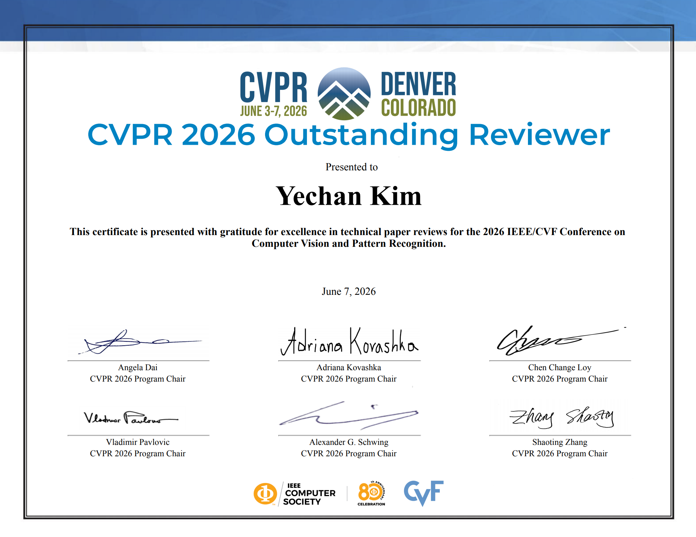

Yechan Kim (LIG Defense&Aerospace), currently a Research Engineer at the AI Lab. of LIG Defense&Aerospace, is honored to have been selected as an Outstanding Reviewer for CVPR 2026, one of the most prestigious conferences in computer vision and pattern recognition. He was recognized among the top 5% of 17,491 reviewers for his exceptional contributions to the peer-review process. Congrat! 🎉

김예찬 (LIG Defense&Aerospace AI랩 선임연구원, 2026년 7월 기준)은 컴퓨터 비전 및 패턴 인식 분야 최고 권위 학회 CVPR 2026에서 전체 17,491명 리뷰어 중 상위 5% 리뷰어에 선정되어 우수 리뷰어 (Outstanding Reviewer) 상을 수상하는 영예를 안았습니다. 축하합니다! 🎉

