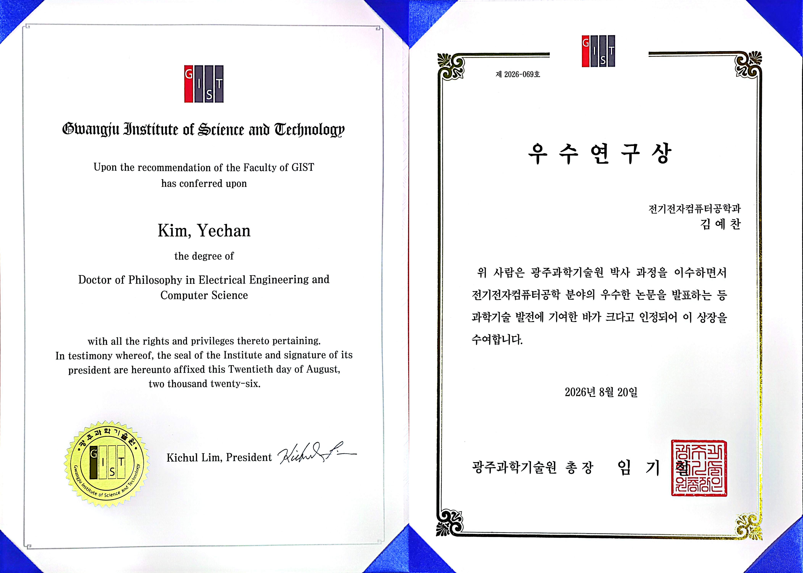
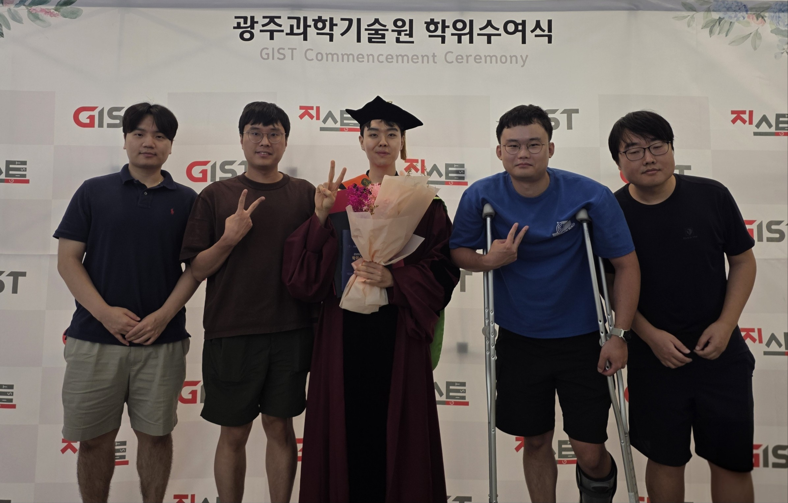

Yechan Kim earned his **Ph.D.** degree from the School of Electrical Engineering and Computer Science (EECS) at GIST on August 20, 2026. 
In recognition of his outstanding research achievements, he was also selected to represent the GIST EECS and received the **Outstanding Research Award** from the President of GIST. Congrat! 🎉

김예찬 (LIG Defense&Aerospace AI랩 선임연구원, 2026년 8월 기준)은 2026년 8월 20일 GIST 전기전자컴퓨터공학부에서 박사학위를 취득하였습니다. 또한, 김예찬은 전기전자컴퓨터공학부를 대표하여 우수연구상 (총장상)을 수상하였습니다. 축하합니다! 🎉

